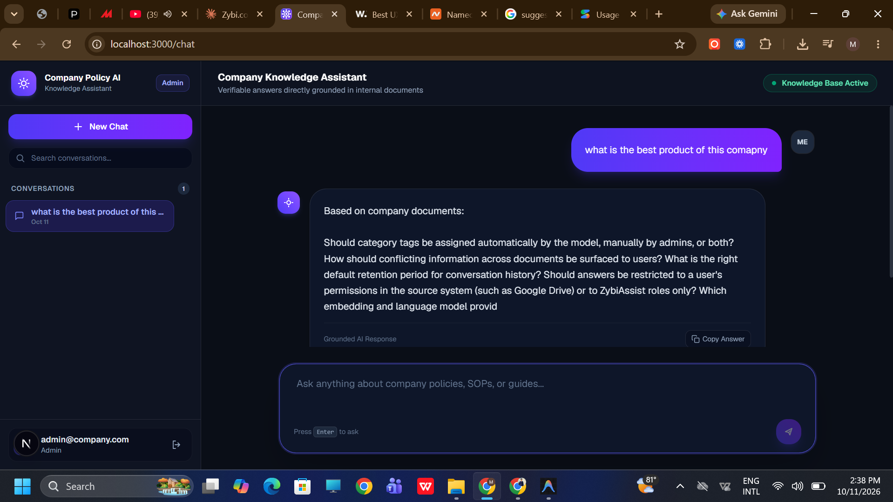
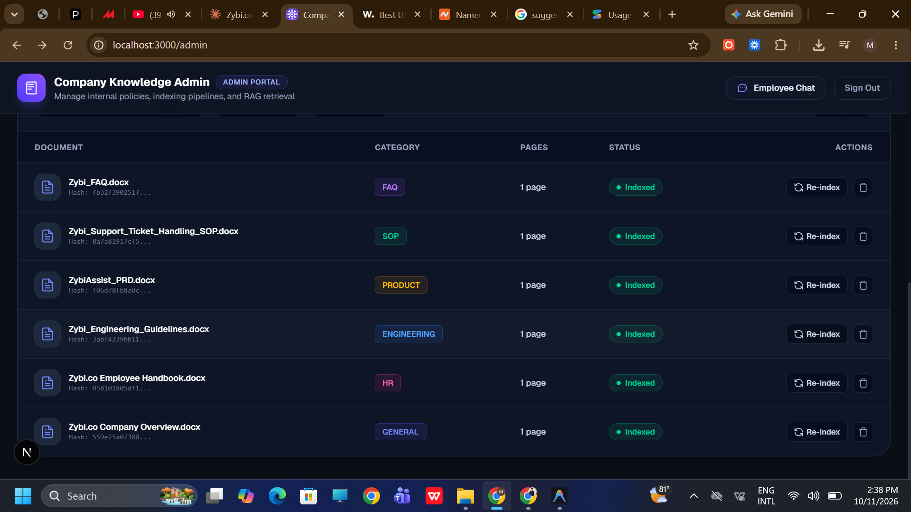
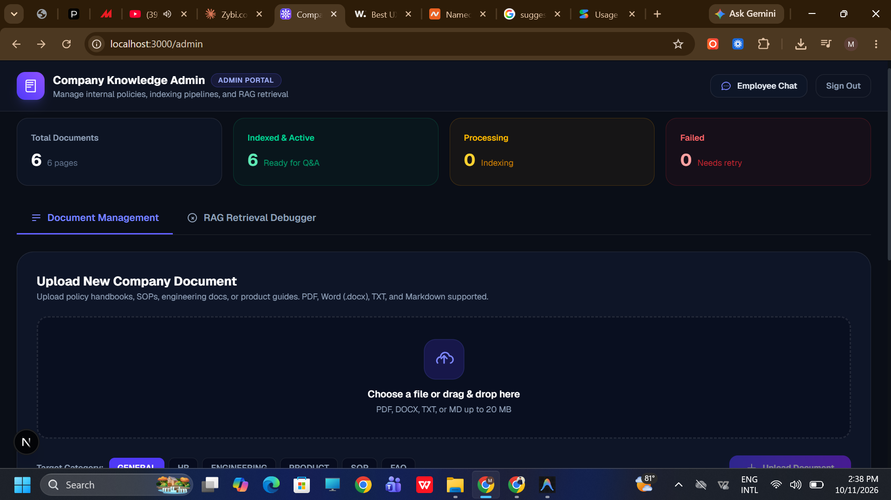
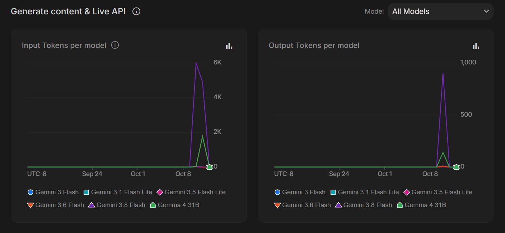

# Company Policy AI — Enterprise RAG Assistant

> **Instant, verifiable answers grounded in your company''s internal documents.**
> Built with Google Gemini embeddings + ChromaDB vector search + FastAPI + Next.js.

---

## Screenshots

### Employee Chat Interface

Ask any question in natural language. The assistant retrieves the most relevant document chunks and generates a direct, cited answer.



---

### Admin Dashboard — Document Management

Admins upload, categorize, and manage all company documents. Each document is parsed, chunked, and indexed automatically into the vector store.



---

### Document Upload and Indexing

Drag-and-drop upload with automatic category tagging (HR, Engineering, Product, SOP, FAQ, General). Supports PDF, DOCX, TXT, and Markdown.



---

### Gemini API Usage

Live token consumption across all Gemini models — embeddings and answer generation tracked in Google AI Studio.



---

## Knowledge Base — Company Documents Used

The assistant was built and tested against **Zybi.co's** internal document set. All 6 documents are indexed and searchable:

| Document | Category | Contents |
|---|---|---|
| `Zybi.co Employee Handbook.docx` | **HR** | PTO policy (20 to 25 days by tenure), sick leave, parental leave, resignation process, attendance, code of conduct |
| `Zybi.co Company Overview.docx` | **General** | Company mission, vision, org structure, culture, key metrics |
| `Zybi_Engineering_Guidelines.docx` | **Engineering** | Git branching standards, code review process, CI/CD pipeline, API design principles, on-call rotations |
| `ZybiAssist_PRD.docx` | **Product** | Product requirements for ZybiAssist AI, feature specs, success metrics, open design questions |
| `Zybi_Support_Ticket_Handling_SOP.docx` | **SOP** | Step-by-step support ticket workflow, escalation matrix, SLA targets, resolution procedures |
| `Zybi_FAQ.docx` | **FAQ** | Frequently asked employee questions across HR, engineering, and product topics |

> Sample documents are available in the `testing docs/` folder.

---

## Architecture

```
Frontend (Next.js 16)
  Login Page | Chat UI (Employee) | Admin Dashboard

         REST API (JWT protected)

Backend (FastAPI 0.115)
  Auth Router | Chat Router | Document Router
                      |
              RAG Pipeline
              1. Bucket Router  (keyword rules + Gemini classifier)
              2. Query Embedding (gemini-embedding-001, 3072-dim)
              3. Vector Search   (ChromaDB, top-14 candidates, cosine >= 0.45)
              4. Re-rank and Deduplicate chunks
              5. Answer Generation (gemini-3.5-flash, structured JSON)
              6. Citation extraction and SQLite caching

SQLite DB                     ChromaDB
(sessions, messages,          (vector store, 81+ chunks,
 cache, documents)             3072-dim embeddings)
```

---

## RAG Pipeline — How It Works

### 1. Document Ingestion

```
Upload (PDF / DOCX / TXT / MD)
  -> Parser (PyMuPDF + python-docx) extracts page-aware sections
  -> Chunker splits into ~375-word chunks with 45-word overlap
  -> Gemini Embedding (gemini-embedding-001, RETRIEVAL_DOCUMENT task)
  -> ChromaDB stores vectors + metadata (filename, page, section, bucket)
```

### 2. Query and Answer

```
User question
  -> Bucket Router: keyword rules -> Gemini fast model (category classification)
  -> Embed query with gemini-embedding-001 (RETRIEVAL_QUERY task type)
  -> ChromaDB cosine similarity search (top-14 candidates, threshold >= 0.45)
  -> Merge adjacent chunks, deduplicate, keep top-6 within 6000-token budget
  -> gemini-3.5-flash generates structured Markdown answer with cited chunk IDs
  -> Citations extracted and returned alongside the answer
  -> Answer cached in SQLite (invalidated on new document index)
```

### 3. Document Category Routing (Buckets)

| Bucket | Keyword triggers |
|---|---|
| `hr` | leave, salary, holiday, payroll, benefit, employee, vacation, insurance, bonus … |
| `engineering` | deploy, pipeline, api, code, database, server, architecture, build, git, ci/cd … |
| `product` | refund, pricing, plan, subscription, feature, customer, billing, tier … |
| `sop` | procedure, process, workflow, standard, checklist, guideline, protocol … |
| `faq` | faq, frequently, question, answer, help … |
| `general` | everything else |

---

## Getting Started

### Prerequisites

- Python 3.11+
- Node.js 18+
- A [Google AI Studio](https://aistudio.google.com/) API key (free tier works)

---

### Backend Setup

```bash
cd backend

# Create and activate virtual environment
python -m venv .venv
.venv\Scripts\activate          # Windows
# source .venv/bin/activate     # macOS/Linux

# Install dependencies
pip install -r requirements.txt

# Configure environment
copy .env.example .env
# Open .env and set your GEMINI_API_KEY

# Seed default users (admin + employee)
python seed.py

# Start the API server
python -m uvicorn app.main:app --reload --host 127.0.0.1 --port 8000
```

API available at: `http://localhost:8000`
Swagger docs at: `http://localhost:8000/docs`

---

### Frontend Setup

```bash
cd frontend

# Install dependencies
npm install

# Configure environment
copy .env.local.example .env.local

# Start the dev server
npm run dev
```

App available at: `http://localhost:3000`

---

### Environment Variables

**`backend/.env`**

```env
JWT_SECRET=your_strong_secret_here
GEMINI_API_KEY=your_gemini_api_key_here
GEMINI_EMBED_MODEL=gemini-embedding-001
GEMINI_FAST_MODEL=gemini-3.5-flash
GEMINI_ANSWER_MODEL=gemini-3.5-flash
```

**`frontend/.env.local`**

```env
NEXT_PUBLIC_API_URL=http://localhost:8000
```

---

### Default Login Credentials

| Role | Email | Password |
|---|---|---|
| **Admin** | `admin@company.com` | `admin123` |
| **Employee** | `employee@company.com` | `employee123` |

> Change these credentials before any production deployment.

---

## Running Tests

```bash
cd backend
.venv\Scripts\activate
pytest tests/ -v
```

All **26 unit tests** pass covering auth, chat sessions, chunking, embeddings, indexing, LLM generation, RAG pipeline, retrieval, bucket routing, document upload, and vector store.

---

## Tech Stack

| Layer | Technology |
|---|---|
| **Frontend** | Next.js 16, React 19, Tailwind CSS 4 |
| **Backend** | FastAPI 0.115, Uvicorn, SQLAlchemy 2 |
| **AI / Embeddings** | Google Gemini `gemini-embedding-001`, `gemini-3.5-flash` |
| **Vector Store** | ChromaDB 1.x (local persistent) |
| **Database** | SQLite via SQLAlchemy |
| **Auth** | JWT (PyJWT + bcrypt) |
| **Document Parsing** | PyMuPDF (PDF), python-docx (DOCX) |
| **Testing** | pytest 8.4 |

---

## Project Structure

```
AI Company Policy Assistant/
├── backend/
│   ├── app/
│   │   ├── routers/              # FastAPI route handlers
│   │   │   ├── auth.py
│   │   │   ├── chat.py
│   │   │   └── documents.py
│   │   ├── services/
│   │   │   ├── rag.py            # Top-level RAG orchestration + caching
│   │   │   ├── retriever.py      # Vector search, merge, dedup, token budget
│   │   │   ├── llm.py            # Gemini answer generation + retry logic
│   │   │   ├── embeddings.py     # Gemini embedding with rate-limit retry
│   │   │   ├── router_bucket.py  # Document category classification
│   │   │   ├── chunker.py        # Sentence-aware text chunking with overlap
│   │   │   ├── parser.py         # PDF / DOCX / TXT parsing
│   │   │   ├── indexing.py       # Full indexing pipeline
│   │   │   ├── vector_store.py   # ChromaDB client
│   │   │   └── cache.py          # Answer cache (SQLite)
│   │   ├── config.py             # Settings and defaults
│   │   ├── models.py             # SQLAlchemy ORM models
│   │   ├── schemas.py            # Pydantic request/response schemas
│   │   ├── auth.py               # JWT helpers
│   │   └── main.py               # FastAPI app entry point
│   ├── tests/                    # 26 unit tests
│   ├── seed.py                   # Database seeder
│   └── requirements.txt
│
├── frontend/
│   ├── app/
│   │   ├── login/                # Login page
│   │   ├── chat/                 # Employee chat interface
│   │   └── admin/                # Admin dashboard
│   └── lib/                      # API client helpers
│
├── screenshots/                  # UI screenshots
├── testing docs/                 # Sample Zybi.co company documents
└── README.md
```

---

## User Roles and Permissions

| Feature | Employee | Admin |
|---|---|---|
| Ask questions via chat | Yes | Yes |
| View own chat history | Yes | Yes |
| Upload documents | No | Yes |
| Delete documents | No | Yes |
| Re-index documents | No | Yes |
| Admin dashboard | No | Yes |
| RAG Retrieval Debugger | No | Yes |

---

## License

This project is for demonstration and internal use. All sample documents belong to **Zybi.co** and are used for RAG testing and demonstration purposes only.
